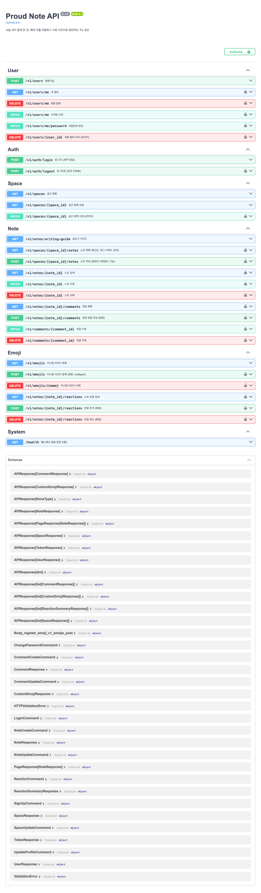
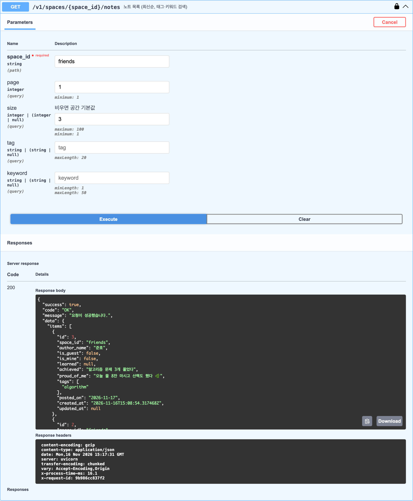
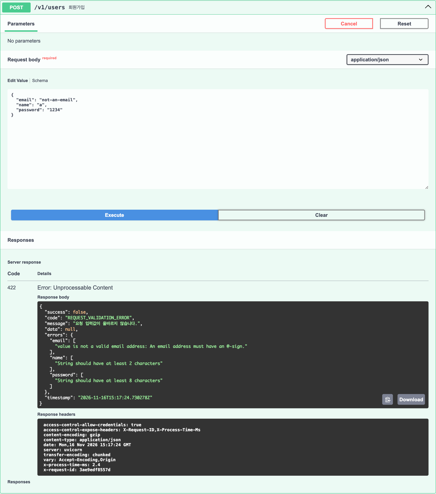
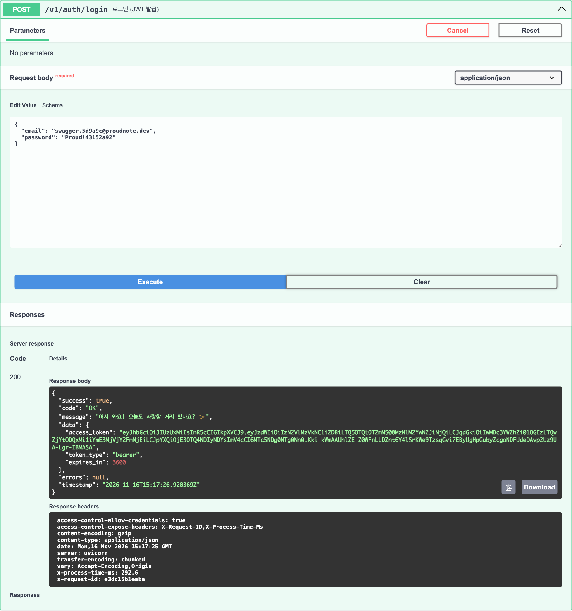
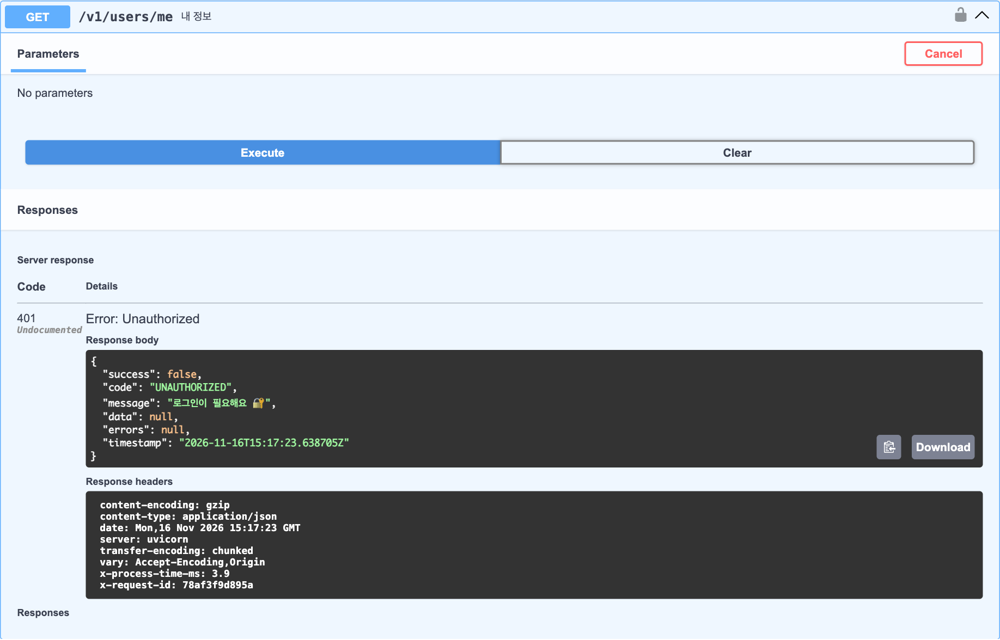
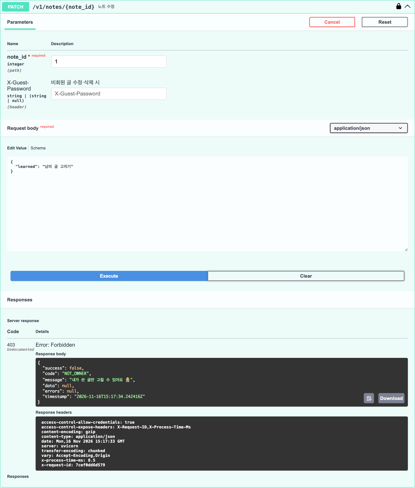
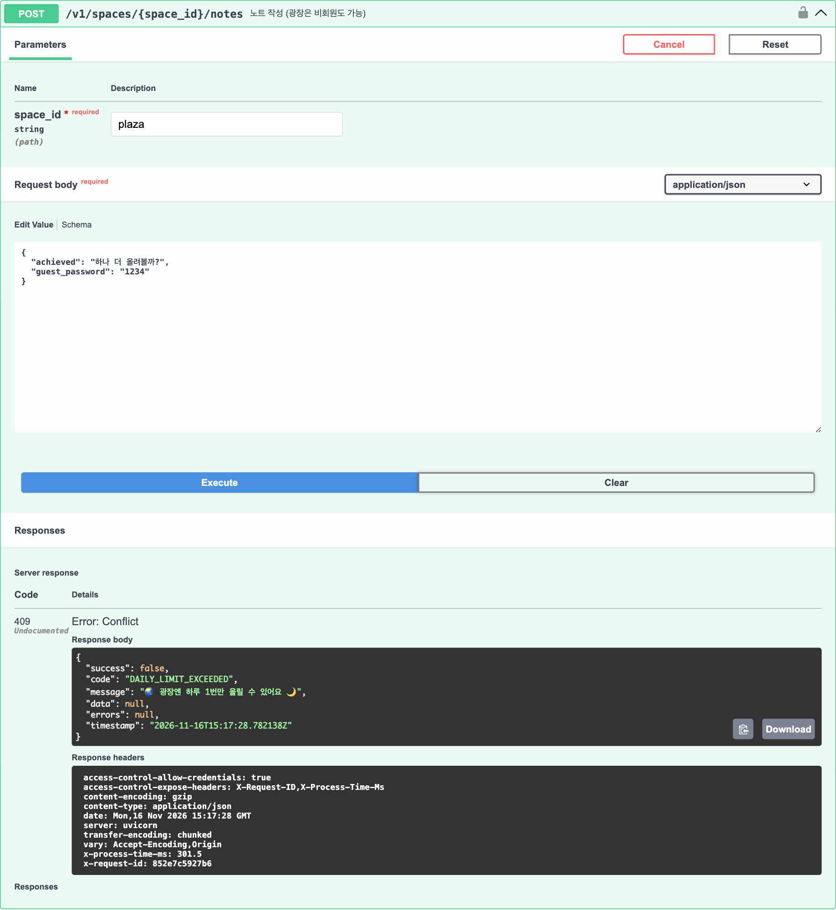
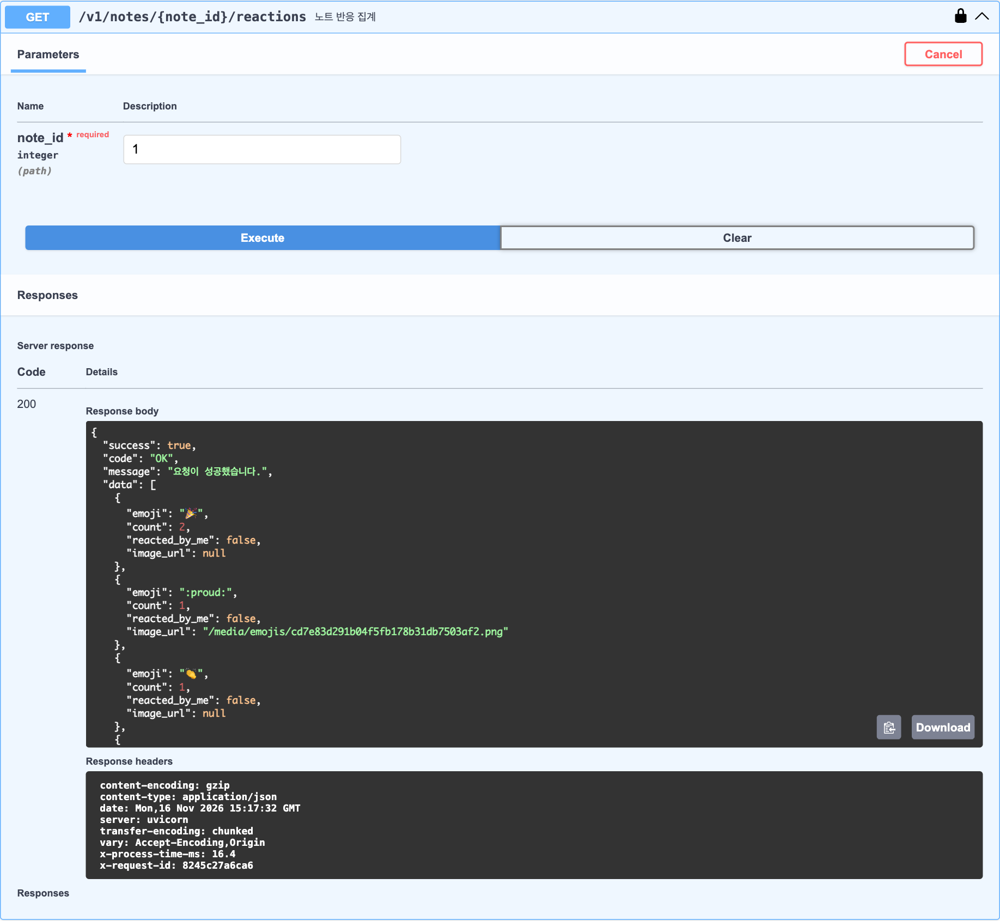

# 🌱 Proud Note API

오늘 **알게 된 것 · 해낸 것 · 오늘의 나**를 기록하고, 친구들이 이모지로 칭찬해 주는 TIL 게시판 RESTful API.

| 제출 항목 | 주소 |
|---|---|
| **배포 서비스 (Swagger UI)** | http://43.200.44.137/docs |
| 헬스체크 | http://43.200.44.137/health |
| GitHub | https://github.com/bsis09872-ux/proud-note |

**스택**: Python 3.13 · FastAPI · Pydantic v2 · SQLAlchemy 2 (async) · PostgreSQL 17 · Alembic · JWT(HS512) · bcrypt · Docker · AWS EC2



---

## 과제 요구사항 대응

| 구분 | 요구사항 | 구현 |
|---|---|---|
| 필수 | RESTful 게시판 API | 리소스 중심 URL + HTTP 메서드(GET/POST/PATCH/DELETE) + 상태코드(201·401·403·404·409·422) |
| 필수 | PostgreSQL + SQLAlchemy | async SQLAlchemy 2 ORM, Alembic 마이그레이션, 테이블 8개 |
| 필수 | JWT 인증·인가 | 회원가입·로그인·로그아웃(블랙리스트), 작성자 검증, 관리자 권한 |
| 필수 | Swagger UI | `/docs`에서 Authorize 후 바로 테스트 가능 |
| 심화 | 클라우드 배포 | Docker + AWS EC2 (서울 리전), 탄력적 IP |
| 심화 | 보안·예외 처리 | 공통 에러 스키마, bcrypt 해싱, 토큰 만료·폐기, IP 해시 |
| 심화 | 검증·직렬화 표준화 | Pydantic Command/Query 스키마 + 도메인 검증 → 필드별 오류 응답 |

---

## 1. RESTful API

| 리소스 | 엔드포인트 | 권한 |
|---|---|---|
| 회원 | `POST /v1/users` · `GET/PATCH/DELETE /v1/users/me` · `PATCH /v1/users/me/password` · `DELETE /v1/users/{id}` | 가입 외 로그인 (마지막은 관리자) |
| 인증 | `POST /v1/auth/login` · `POST /v1/auth/logout` | - |
| 공간 | `GET /v1/spaces` · `GET /v1/spaces/{id}` · `PATCH /v1/spaces/{id}` | 수정은 관리자 |
| 노트 | `GET/POST /v1/spaces/{id}/notes` · `GET/PATCH/DELETE /v1/notes/{id}` | 공간 정책 + 작성자 |
| 댓글 | `GET/POST /v1/notes/{id}/comments` · `PATCH/DELETE /v1/comments/{id}` | 회원 + 작성자 |
| 이모지 | `GET/POST /v1/emojis` · `DELETE /v1/emojis/{name}` | 등록·삭제는 회원 |
| 반응 | `GET/POST/DELETE /v1/notes/{id}/reactions` | 추가·취소는 회원 |
| 기타 | `GET /v1/notes/writing-guide` · `GET /health` | - |

- 목록은 페이징(`page`, `size`)과 검색(`tag`, `keyword`)을 지원해요.
- 게시판 하나 = 공간(Space) 하나. 공간마다 정책이 달라요.

| 정책 | 🏡 friends | 🌏 plaza |
|---|---|---|
| 열람 / 작성 | 회원 / 회원 | 누구나 / 회원+비회원 |
| 작성자 표시 | 닉네임 | 익명 |
| 하루 작성 | 무제한 | 1인 1개 |
| 보관 | 무제한 | 최신 50개 (초과분 자동 삭제) |
| 댓글 / 반응 | O / 회원 | X / 회원 |

| 광장 목록 (비회원 열람·익명) | 친구 공간 목록 (로그인·페이징) |
|---|---|
|  |  |

## 2. Pydantic 데이터 검증 · 직렬화

- 요청은 `XxxCommand` / `XxxQuery`, 응답은 `XxxResponse`로 나눴어요 (CQRS 스타일).
- 성공과 실패 모두 같은 모양으로 응답해요: `{ success, code, message, data, errors, timestamp }`.
- 형식 오류는 Pydantic이, 비즈니스 규칙(비밀번호 규칙, 노트 3칸 중 1칸 필수 등)은 도메인이 검증해요. 두 경우 모두 **필드별 오류**로 반환해요.

```json
{ "success": false, "code": "REQUEST_VALIDATION_ERROR",
  "message": "요청 입력값이 올바르지 않습니다.",
  "errors": { "email": ["value is not a valid email address ..."], "name": ["..."] } }
```



## 3. SQLAlchemy ORM · DB

```
users ─┬─< notes >── spaces          notes ─< note_comments
       ├─< note_comments              notes ─< note_reactions >── users
       ├─< note_reactions             custom_emojis (created_by → users)
       └─< custom_emojis              token_blacklist
```

- **async 엔진**: asyncpg 기반 비동기 세션. 요청 하나가 트랜잭션 하나예요.
- **Alembic**: 스키마와 기본 공간 시드를 마이그레이션으로 관리해요. 서버가 시작될 때 자동으로 적용돼요.
- **쿼리 효율**: 목록 조회에 `(space_id, created_at)` 인덱스, 태그 검색에 GIN 인덱스(`@>`)를 쓰고, 반응 수는 `GROUP BY`로 한 번에 집계해요.
- **무결성**: 반응 중복을 UNIQUE 제약 + `ON CONFLICT`로 막고, FK `ON DELETE CASCADE / SET NULL`을 설정했어요.
- **동시성**: 광장 작성 시 `pg_advisory_xact_lock`으로 같은 공간의 요청을 순서대로 처리해서, 하루 1개·최대 50개 제한이 동시 요청에도 지켜져요.

## 4. 인증 · 인가

| 항목 | 구현 |
|---|---|
| 비밀번호 | bcrypt 해싱, 규칙: 8자 이상 + 영문·숫자·특수문자 |
| 토큰 | JWT HS512 (키는 64자 이상이어야 서버가 시작됨), 60분 만료 |
| 로그아웃 | 토큰 `jti`를 블랙리스트에 등록해서 즉시 무효화 |
| 인가 | 작성자 본인만 수정·삭제 (관리자는 예외), 관리자 전용 API, 공간별 열람·작성 권한 |
| 비회원 | 비밀번호(bcrypt)로 수정·삭제를 검증하고, IP는 HMAC 해시로만 저장 |
| 기타 | 탈퇴 회원 차단, 존재하지 않는 이메일로 로그인해도 응답 시간이 같게 처리 |

| 로그인 (JWT 발급) | 미인증 401 | 작성자 아님 403 |
|---|---|---|
|  |  |  |

## 5. 서비스 구성 · 운영

| 항목 | 구현 |
|---|---|
| 비동기 | 라우터부터 DB까지 전 구간 `async` (asyncpg) |
| 업로드 | 커스텀 이모지 이미지(PNG·GIF·JPG·WEBP, 256KB) 업로드. 확장자가 아니라 파일 시그니처로 형식을 검사하고, `/media`로 제공해요 |
| 캐싱 | 이모지 목록(TTL 5분)과 반응 집계(TTL 30초)를 메모리 캐시에 담고, 데이터가 바뀌면 바로 비워요 |
| 미들웨어 | 요청마다 ID(`X-Request-ID`)를 붙여 로그에 남기고, 처리 시간(`X-Process-Time-Ms`)을 기록해요. CORS·GZip도 적용했어요 |
| 예외 처리 | `AppException` 계층 + 전역 핸들러 4종 (비즈니스·검증·HTTP·예상 못한 오류). 500 오류는 내부 정보를 숨겨요 |
| 테스트 | pytest 통합 테스트 21개 (실제 PostgreSQL + 마이그레이션 적용) |
| 배포 | 멀티 스테이지 Dockerfile, root가 아닌 사용자로 실행, 헬스체크, `--proxy-headers` |

| 광장 하루 1개 제한 (409 + 요청 ID 헤더) | 반응 집계 (커스텀 이모지 포함) |
|---|---|
|  |  |

---

## 구조

```
src/
├── shared/core/   # 설정·로깅·DB·공통 응답·예외·미들웨어
├── wiring/        # 의존성 주입 연결 (dependency_overrides)
└── user | auth | space | note | emoji/
    ├── domain/          # 엔티티·비즈니스 규칙·리포지토리 인터페이스
    ├── application/     # 서비스 + Command/Query DTO
    ├── infrastructure/  # SQLAlchemy 모델·저장소·보안
    └── presentation/    # 라우터·응답 스키마
```

## 실행

```bash
cp .env.example .env              # JWT_SECRET_KEY 64자 이상
docker compose up -d              # 로컬 PostgreSQL (5433)
uv sync && uv run alembic upgrade head
uv run uvicorn main:app --reload --app-dir src
uv run pytest
```

**배포 (EC2)**
```bash
docker compose --env-file .env.prod -f docker-compose.prod.yml --profile local-db up -d --build
```
